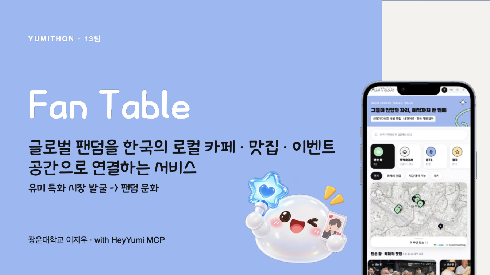
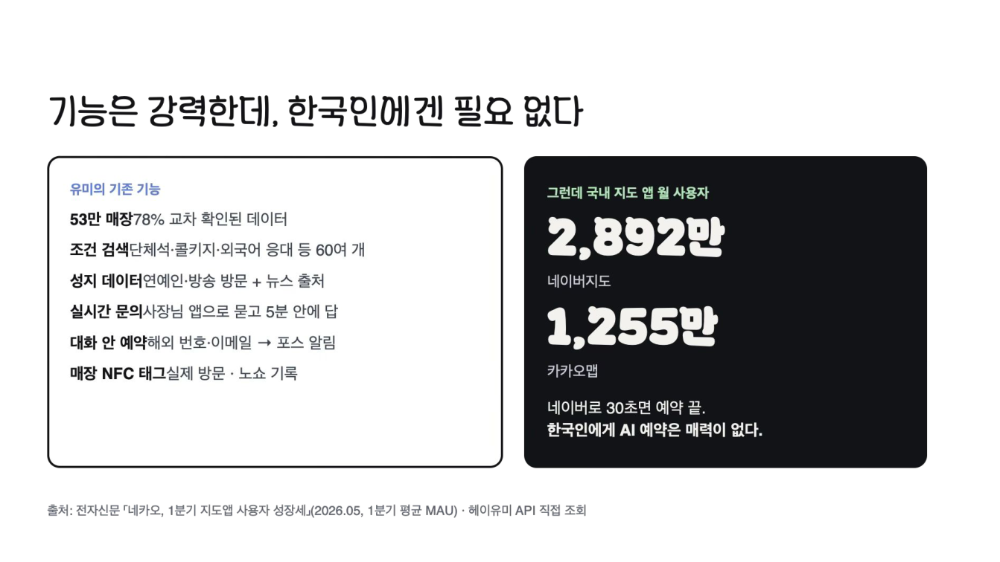
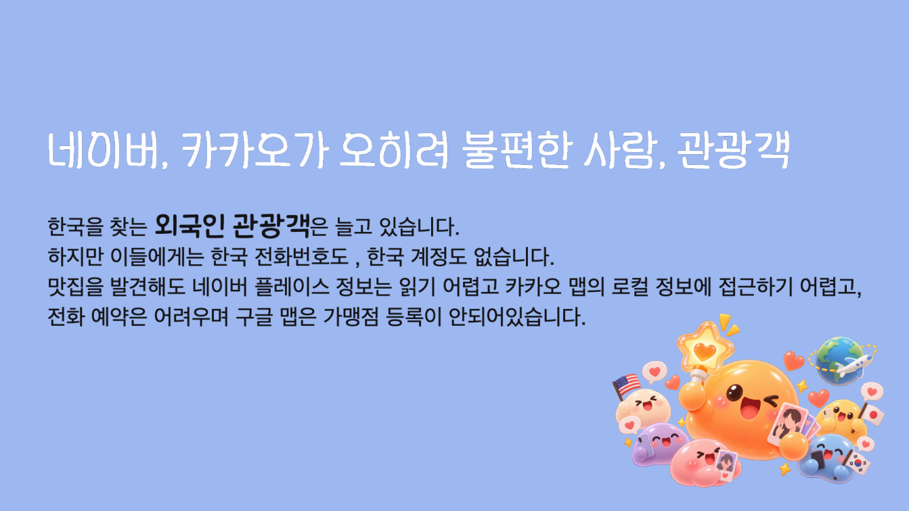
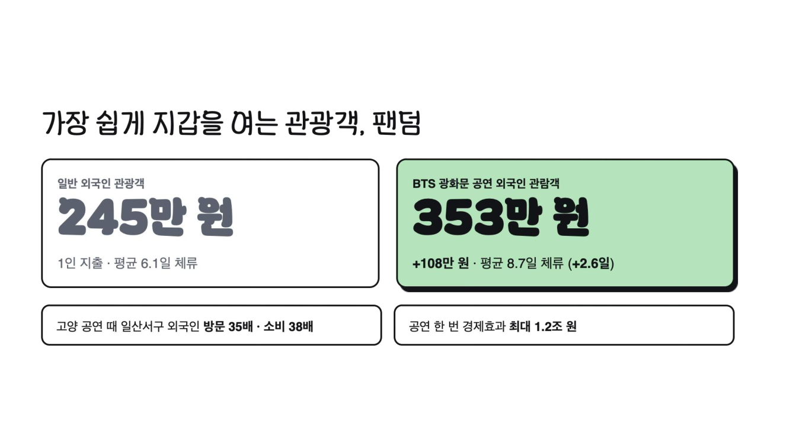
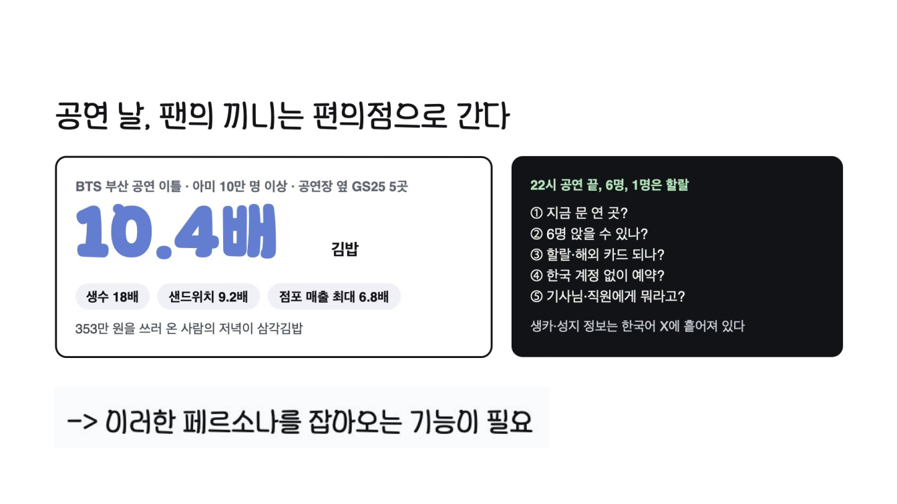
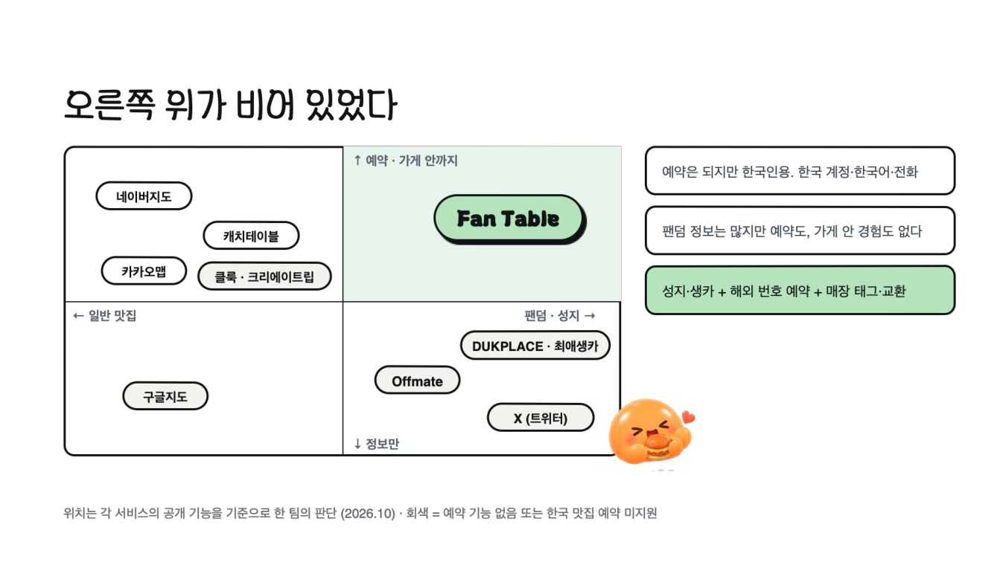
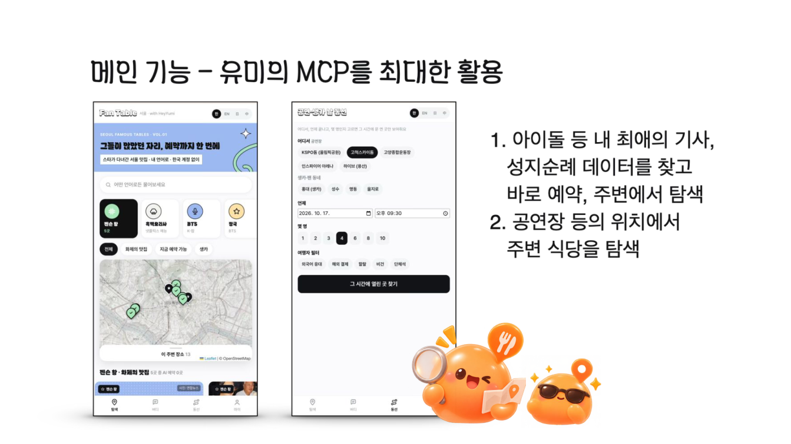
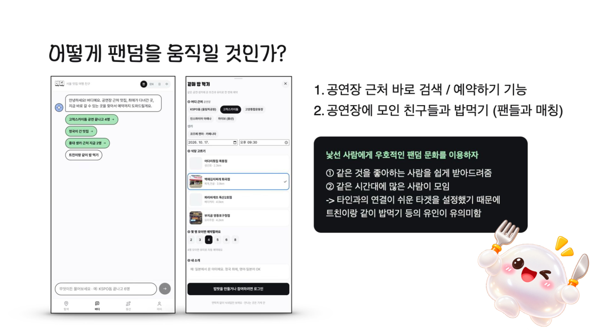
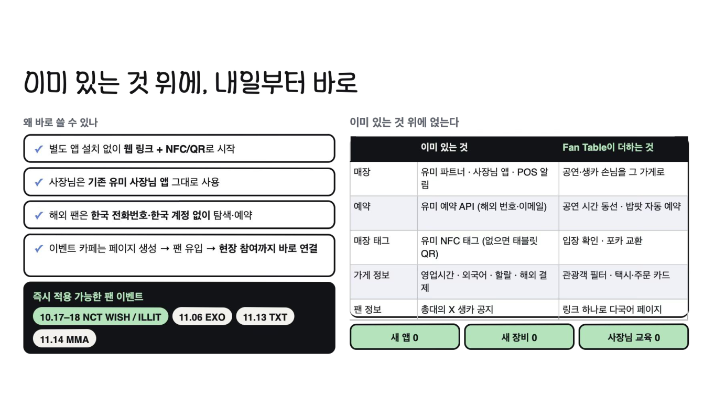
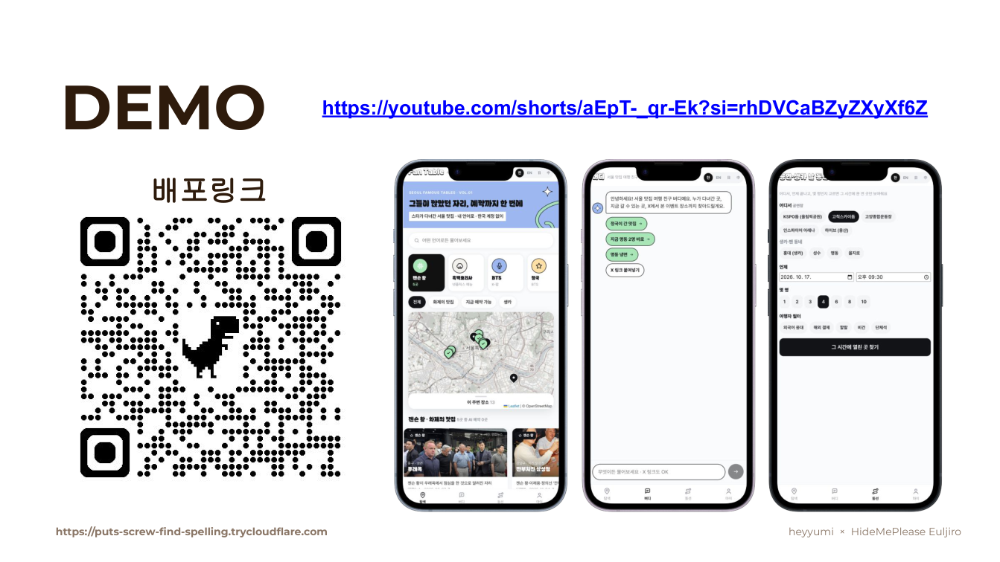

<div align="center">

# Fan Table

**글로벌 팬덤을 한국의 로컬 카페 · 맛집 · 이벤트 공간으로 연결하는 서비스**

🏆 **YUMITHON 2위 / 21팀** · 유미톤 13팀 · heyyumi × HideMePlease Euljiro (2026.10.17)

[▶ 데모 영상](https://youtube.com/shorts/aEpT-_qr-Ek?si=rhDVCaBZyZXyXf6Z) · [📄 발표 자료 (PDF)](docs/YUMITHON_13팀_최종발표.pdf) · [수상 소식](https://lnkd.in/p/gTSHP_bY)

</div>



> 해외 팬이 공연·생카 날, **한국 계정 없이 '그 시간에 열린' 맛집을 찾고 예약하고, 가게 안에서 팬끼리 만나게** 한다.
> 광운대학교 이지우 · 헤이유미 REST API / MCP 위에서 동작 · 한국어 · English · 日本語 · 中文

---

## 어떤 고민으로 만들었나

### 1. 헤이유미는 강력한데, 한국인에겐 필요 없었다



53만 매장, 60여 개 조건 검색, 연예인 성지 데이터, 사장님 실시간 문의, 대화 안 예약, 매장 NFC 태그까지. 그런데 한국인은 이미 네이버지도(MAU 2,892만)·카카오맵(1,255만)으로 30초면 예약이 끝난다. **"AI로 예약하기"는 한국인에게 매력이 없다.** 그래서 질문을 바꿨다 — *네이버가 오히려 불편한 사람은 누구일까?*

### 2. 네이버·카카오가 오히려 불편한 사람, 관광객



한국 전화번호도, 한국 계정도 없다. 플레이스 정보는 읽기 어렵고, 전화 예약은 말이 안 통하고, 구글 맵엔 가게가 없다. Reddit 여행 글 7,260건을 보면 한국 여행에서 불편을 적은 글은 **11%(일본 7%)**, 그중 **디지털 문제가 27.8%**로 가장 크다 — 불편은 현장이 아니라 **스마트폰 화면에서** 시작된다. <sub>(야놀자리서치, 2026.4)</sub>

### 3. 그중에서도, 가장 쉽게 지갑을 여는 관광객 — 팬덤



BTS 광화문 공연 외국인 관람객은 1인 **353만 원 · 8.7일**(일반 외국인 245만 원 · 6.1일). 고양 공연 때 일산서구 외국인 소비는 38배. 팬은 **갈 날짜와 장소를 정하고** 온다.

### 4. 그런데 공연 날, 팬의 끼니는 편의점으로 간다



BTS 부산 공연 이틀 동안 공연장 옆 편의점 김밥 매출이 **10.4배**. 22시 공연이 끝나면 6명이, 1명은 할랄로, 한국 계정 없이 갈 곳을 혼자 찾아야 한다 — 지금 문 연 곳? 6명 앉을 수 있나? 할랄·해외 카드 되나? 기사님·직원에게 뭐라고? <sub>(머니투데이 2026.6.15 · 편의점 수치의 해석은 팀 판단)</sub>

**→ 이 페르소나를 잡아오는 기능이 필요했다.**

### 5. 오른쪽 위가 비어 있었다



네이버·카카오·캐치테이블은 예약은 되지만 한국인용이고(네이버는 2026.6 여권 인증을 열었지만 팬의 맥락은 없다), DUKPLACE·X는 팬덤 정보는 많지만 예약도 가게 안 경험도 없다. **팬덤 맥락 × 예약·가게 안까지**가 비어 있었다.

---

## 무엇을 만들었나

### 유미 MCP를 최대한 활용한 메인 기능



1. **성지 지도** — 최애가 다녀간 가게(뉴스 출처)를 찾고 바로 예약, 주변 탐색
2. **동선** — 공연장·생카 + 시간 + 인원 + 관광객 필터(외국어 응대 · 해외 결제 · 할랄 · 비건 · 단체석) → **그 시간에 열고 바로 예약되는 곳**

### 어떻게 팬덤을 움직일 것인가



낯선 사람에게 우호적인 팬덤 문화를 이용했다 — 같은 것을 좋아하는 사람을 쉽게 받아들이고, 같은 시간대에 많은 사람이 모인다.

1. **버디 AI** — "고척스카이돔 공연 끝나고 4명", "정국이 간 맛집"으로 바로 검색 · 사장님 동시 문의 · 예약
2. **같이 밥 먹기 (밥팟)** — 식당을 고르고 "4명 모이면 예약" + 내 소개 → X로 트친 초대 → 인원이 차는 순간 유미로 **자동 예약**
3. **매장 태그 · 포카 교환** — 가게 NFC/QR 태그를 찍으면 자동 입장, 팝업에서 "정국 포카 가진 사람 1명" 매칭 → 가게 안 대면 교환 (송금·택배·연락처 차단)

그 밖에: 해외 번호·이메일 예약 · 택시 카드 · 주문 도움 카드 · 생카 등록(X 링크) · 카카오 로그인 · 사장님 수요 리포트("예약되면 좋겠어요"가 언어별로 쌓인다 — **실패한 예약이 영업사원이 된다**)

### 이미 있는 것 위에, 내일부터 바로



새 앱 0 · 새 장비 0 · 사장님 교육 0. 유미 파트너 · 사장님 앱 · 예약 API · 매장 태그 위에 공연과 생카를 얹을 뿐이다. 공연 끝나는 시간 KSPO돔·고양·인스파이어 반경 5km 안 유미 예약 가능 파트너는 **0곳** — 수요는 있는데 공급이 비어 있는, 헤이유미가 영업할 곳 지도다. <sub>(헤이유미 API 직접 조회, 2026.10.17)</sub>

### DEMO



[▶ 데모 영상 (YouTube Shorts)](https://youtube.com/shorts/aEpT-_qr-Ek?si=rhDVCaBZyZXyXf6Z) · 발표 당시 배포 링크는 임시 터널이라 지금은 닫혀 있어요. 로컬 실행은 아래를 참고하세요.

---

## 어떻게 동작하나 — 찾기 → 확인 → 예약 요청

| 단계 | 헤이유미 API |
|---|---|
| 찾기 | `places/nearby` (`open_at`, `reservation_channel=yumi`, `foreigner_friendly`, `payment_methods`, `muslim_friendly`, `dietary`, `recommended_for`) · `associated_with`(성지) · `regions` |
| 확인 | `places/{id}` (메뉴·사진·외국어·결제) · `live-status` 사장님 4명께 동시에 "지금 4명 돼요?" |
| 예약 요청 | `reservations` (해외 번호·이메일 · 밥팟은 목표 인원 도달 시 서버가 1회만 요청) → `reservations/{id}` 상태 확인 |
| 현장 | 매장 태그 5분 회전 서명 토큰 → 입장 확인 · 포카 교환 |

## 만들면서 배운 것

- `nearby`의 `open_at` + `reservation_channel=yumi` 조합으로 "그 시간에 예약되는 곳"이 한 번에 나온다. 파트너가 없으면 `reservationFallback`으로 알려줘서, 그대로 사장님 수요 리포트로 연결했다.
- REST에는 `group_friendly` 파라미터가 없어 `recommended_for=group_dining`으로 대신했다.
- 공연장(KSPO·고양·인스파이어)은 `regions`로 안 잡혀서 좌표를 직접 넣었다.
- 샌드박스(`X-Map3-Sandbox`)로 사장님께 알림 없이 예약 확정까지 전 과정을 검증했다.

---

## 개발 · 실행

```bash
npm install
npm run dev
```

`.env.local`:

| 변수 | 설명 |
|---|---|
| `HEYYUMI_API_KEY` | 헤이유미 REST API 키 (필수) |
| `HEYYUMI_SANDBOX` | `1` = 샌드박스(사장님께 알림 안 감, 기본값), `0` = 실제 요청 |
| `ANTHROPIC_API_KEY` | 선택. 버디 대화·번역. 없으면 규칙 기반으로 동작 |
| `SESSION_SECRET` | 세션 서명 키. 없으면 `.data/session-secret`에 자동 생성 |
| `OWNER_INVITES` | 사장님 초대 코드 `코드:매장ID` (쉼표로 여러 개) |
| `NEWS_IMAGES` | `0`이면 뉴스 기사 대표 이미지를 쓰지 않음 (출시 시 권장) |
| `KAKAO_REST_API_KEY` · `KAKAO_CLIENT_SECRET` | 선택. 카카오 로그인 (Redirect URI: `<주소>/api/auth/kakao/callback`) |

## 데이터

- `.data/app.db` — SQLite (Node 내장 `node:sqlite`). 테이블: users, demand, logs, log_likes, events, presence, trades, offers, reports, blocks, meets, meet_members.
- 예약의 이름·전화번호·이메일은 서버에 저장하지 않고 헤이유미로만 전달한다. 밥팟 방장의 예약 연락처만 자동 예약 요청 때까지 보관했다가 요청 즉시 지운다. 내 예약 목록은 기기(localStorage)에만 있다.
- 매장 입장 기록은 2시간, 교환 글은 24시간 뒤 자동 삭제. 계정 삭제 시 그 계정의 모든 데이터가 지워진다.

## 보안 장치

- 로그인: scrypt 비밀번호 + HMAC 서명 HttpOnly 세션 쿠키. 쓰기 API는 모두 로그인 필요.
- 요청 제한: 로그인 시도 10회/10분, 실시간 문의 4회/분(같은 가게 2분 1회), 버디 “지금” 동시 문의 2회/5분 등.
- 매장 태그: 5분마다 바뀌는 서명 토큰(`/tag/<매장>?t=…`), 사장님 앱 QR이 자동 갱신.
- 콘텐츠 필터: 연락처·외부 링크·욕설 차단, 교환 글은 송금·택배 문구도 차단. 신고 3건이면 자동 숨김. 차단한 사람의 글은 안 보임.
- 교환 완료는 양쪽 모두 확인해야 닫힘. 확인 코드는 교환 당사자 두 명만 볼 수 있음.

## 출시 전 남은 일

- Postgres로 이전(서버리스 배포 시 SQLite 파일은 유지되지 않음), 구글·애플 로그인 (카카오 로그인은 적용됨)
- 매장 태그 토큰을 헤이유미 태그 페이지에서 발급받도록 연동
- 알림(예약 확정·교환 제안), X·네이버 공식 검색 API로 생카 수집
- 개인정보 처리방침·이용약관(`/privacy`, `/terms`) 법률 검토, 운영자 신고 검토 화면
